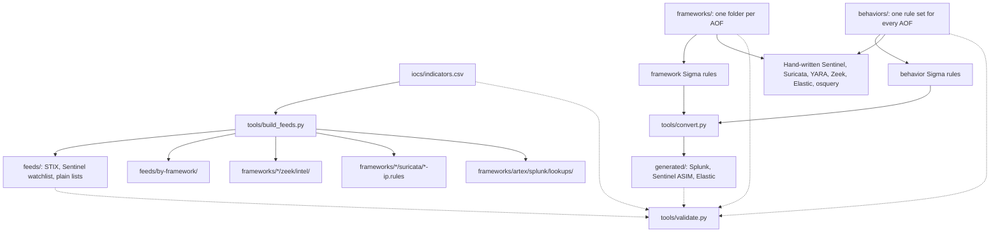
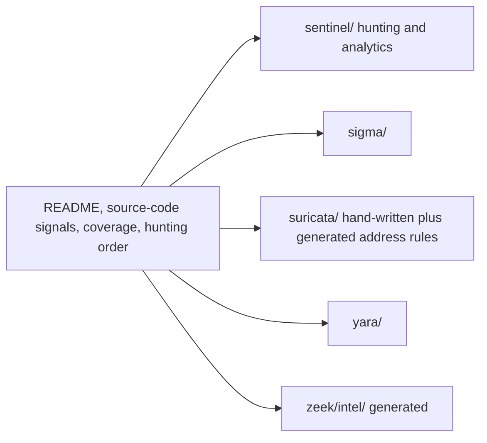

# AOF Attack Detections

Detection content for ongoing attacks that use agentic offensive frameworks (AOFs). An AOF is an open-source platform that hands an intrusion to large language model agents. The operator sets a goal in natural language. The agents plan, run real attack tools, and keep going through reconnaissance, exploitation, persistence, and exfiltration.

This repository is focused on that threat, with **ARTEX** as the AOF the FBI documented. On 13 November 2026 the FBI released [FLASH-20261113-001, *Threat Overview of ARTEX Autonomous Penetration Testing Framework*](https://www.ic3.gov/CSA/2026/261113.pdf) (TLP:CLEAR). A footnote in that FLASH cites Google Threat Intelligence Group, "ARTEX and Friends: Enter Agentic Offensive Frameworks" (30 October 2026). Agentic offensive framework is the name this repository uses for the class. ARTEX is the primary folder. Cairn, PentAGI, HexStrike, CyberStrikeAI, Strix, Hermes Agent, and Agent Zero are other AOFs, each from a review of that project's source and the public reporting on its use. The FBI FLASH itself is about ARTEX and "similar agentic SI frameworks." It does not catalog those other tools.

The content is rules, hunts, and indicators. A match is a lead. Rules are experimental until they have run on your own data.

## Contents

1. [The ARTEX AOF threat](#the-artex-aof-threat)
2. [How the repository is split](#how-the-repository-is-split)
3. [Module structure](#module-structure)
4. [Directory map](#directory-map)
5. [Deploy](#deploy)
6. [Framework catalog](#framework-catalog)
7. [Shared behaviors](#shared-behaviors)
8. [Indicators and feeds](#indicators-and-feeds)
9. [Confidence](#confidence)
10. [Validate and regenerate](#validate-and-regenerate)
11. [Contribute](#contribute)
12. [Names and paths](#names-and-paths)
13. [License](#license)

## The ARTEX AOF threat

Source: FBI IC3 [FLASH-20261113-001](https://www.ic3.gov/CSA/2026/261113.pdf), 13 November 2026. Summarized here. Read the FLASH before you block on its indicators.

ARTEX is an autonomous, multi-agent penetration testing platform written in Go. It does not ship its own model. It calls external providers, including Anthropic Claude, OpenAI GPT, DeepSeek, GLM, Grok, and Kimi. On attacker-controlled instances the FLASH describes, Chinese-origin models are the ones most often used, with the DeepSeek Flash family dominant. Developer "Autumn-27" published it on GitHub in July 2026 and made that repository unavailable on 8 October 2026 after reports of abuse. Copies kept circulating through forks, localized builds, archives, and a commercial build, ARTEX PRO. Check Point researchers, cited in the FLASH, counted more than 1,600 publicly exposed ARTEX consoles in early November 2026. Deployments behind firewalls are not in that count.

The FLASH says malicious use has been underway since at least August 2026, against organizations in financial services, government, technology, defense, semiconductors, energy, healthcare, manufacturing, telecommunications, and legal services. Some intrusions moved from initial targeting to privileged access in under three hours. Two campaigns named in the FLASH: financially motivated attacks on South Korean financial institutions that exfiltrated personal information of about 67,000 people, and a ConnectWise Cloud Backup supply-chain compromise with attempted sign-ins to more than 2,250 downstream tenants.

The FLASH asks defenders to investigate activity, then corroborate it, because cloud and VPN addresses are reassigned. That is why every address in this repository has a `review_by` date. Report suspected ARTEX activity to a local [FBI field office](https://www.fbi.gov/contact-us/field-offices) or to [IC3](https://www.ic3.gov).

Patterns the FLASH describes, and where this repository hunts them:

| What the FLASH describes | Where to look |
|---|---|
| Outbound calls to `api.anthropic.com`, `api.deepseek.com`, `open.bigmodel.cn`, and `api.x.ai`, investigated only next to other suspicious activity | [Hunt 02](behaviors/sentinel/hunting/02-ai-model-api-traffic-from-servers.kql) and [hunt 10](behaviors/sentinel/hunting/10-one-server-calls-several-model-apis.kql). Those four domains are low-confidence rows in [`iocs/indicators.csv`](iocs/indicators.csv), sourced to this FLASH |
| Queries to `api.db-ip.com` for victim geolocation | Same indicator file, low confidence, sourced to this FLASH |
| Web shells, cloud permission dry-runs, Kerberoasting, DCSync, WinRM, and staging to webhook services | [`frameworks/artex/`](frameworks/artex) |
| Residential proxies, Tor, SOCKS proxies, and tunnels such as Chisel and SoftEther | ARTEX hunt 12 (webhook and tunnel services) in [`frameworks/artex/sentinel/hunting/`](frameworks/artex/sentinel/hunting). [Hunt 04](behaviors/sentinel/hunting/04-one-site-probed-through-rotating-proxies.kql) is the related case of one site probed through many proxy addresses |
| Addresses and domains observed in the South Korea, ConnectWise, and Storm-3358 activity | [`iocs/indicators.csv`](iocs/indicators.csv), tagged `artex`, each row naming its source. The FLASH says to vet them against current telemetry before blocking |

The full technique list, the FBI's mitigation steps, and the reporting checklist are in the FLASH. This README does not replace it.

## How the repository is split

Two layers, on purpose.

**Framework folders** hold fingerprints of one AOF: its user agents, command lines, paths, console ports, implants, and campaign infrastructure. Start with [`frameworks/artex/`](frameworks/artex) for the framework in the FBI FLASH. Start with another folder when you already suspect that named tool.

**[`behaviors/`](behaviors)** holds activity that shows up across AOFs: an agent CLI launching attack tools with approvals off, a server calling model APIs, a site probed through rotating proxies, a host calling back to the address that scanned it. One rule covers every framework. Start here when you do not yet know which AOF is in use. Hunts 02 and 10 cover the outbound model-API calls the FLASH says to investigate alongside other activity.

[`iocs/indicators.csv`](iocs/indicators.csv) is the only hand-edited indicator list. [`feeds/`](feeds), the Zeek intel files, and the Suricata address rules are generated from it.

## Module structure

`iocs/indicators.csv` is the only indicator list edited by hand. `tools/build_feeds.py` writes the feeds and the per-framework address rules. Sigma rules in both detection layers are the input to `tools/convert.py`. `tools/validate.py` checks the sources and the generated output.



Each framework folder has the same modules. Suricata address rules and Zeek intel are generated. The other files are written by hand. ARTEX also has a Splunk app, Elastic rules, an osquery pack, and network tests. Agent Zero has no `source-code-signals.md`, `coverage.md`, or `hunting-order.md`.



## Directory map

```text
iocs/indicators.csv          source list for every indicator
feeds/                       STIX, Sentinel watchlist, and plain lists
feeds/by-framework/          the same plain lists, one directory per framework
frameworks/<name>/           rules, hunts, and a write-up for one framework
behaviors/                   rules that apply to every framework
generated/                   Sigma converted to Splunk, Sentinel ASIM, and Elastic
tools/                       feed builder, Sigma converter, validator
docs/adding-a-framework.md   how to add the next framework
```

The file tree for one framework folder matches the diagram above. Do not edit the generated Suricata address rules or the Zeek intel file by hand.

```text
frameworks/<name>/
  README.md
  source-code-signals.md    what the code leaves behind
  coverage.md               behavior by platform
  hunting-order.md          where to start
  sentinel/hunting/         numbered KQL hunts
  sentinel/analytics/       Sentinel scheduled-rule templates
  sigma/                    Sigma rules
  suricata/                 hand-written rules, plus generated address rules
  yara/
  zeek/intel/               generated
```

## Deploy

### Microsoft Sentinel and Defender XDR

1. Upload [`feeds/sentinel-watchlist.csv`](feeds/sentinel-watchlist.csv) as a watchlist. Alias: `AOF_IOCs`. Search key: `value`. If an older copy is already loaded as `AGENTIC_IOCs`, upload this file again under `AOF_IOCs`.
2. Import analytics rules from `frameworks/*/sentinel/analytics/` and [`behaviors/sentinel/analytics/`](behaviors/sentinel/analytics).
3. Run the KQL hunts in `frameworks/*/sentinel/hunting/` and [`behaviors/sentinel/hunting/`](behaviors/sentinel/hunting). Each framework's watchlist sweep filters `AOF_IOCs` to that framework's rows.

The hunts also run in Defender XDR advanced hunting where the tables exist.

### Suricata

Load `frameworks/*/suricata/*.rules` and [`behaviors/suricata/behaviors.rules`](behaviors/suricata/behaviors.rules). HTTP rules need cleartext or decrypted traffic. DNS and TLS SNI rules work on encrypted traffic.

### Zeek

- Shared behaviors: load [`behaviors/zeek/agentic-behaviors/`](behaviors/zeek/agentic-behaviors). Setup and the notice names are in [`behaviors/zeek/README.md`](behaviors/zeek/README.md).
- ARTEX script: `frameworks/artex/zeek/artex/`.
- Indicators: load `frameworks/*/zeek/intel/*.intel` through the Intel framework.

### YARA

Scan container layers, home folders, `/tmp`, and web roots with `frameworks/*/yara/`.

### Sigma, Splunk, and Elastic

Convert `frameworks/*/sigma/` and [`behaviors/sigma/`](behaviors/sigma) with `sigma convert`, or use the copies already in [`generated/`](generated). [`generated/SUMMARY.md`](generated/SUMMARY.md) shows which rule converted to which backend. A dash in that table means no pipeline mapped the rule; use the hand-written query.

ARTEX has its own Splunk app (`frameworks/artex/splunk/`) and Elastic rules (`frameworks/artex/elastic/`). For the other frameworks, use `generated/`.

### Threat intelligence platforms

Import [`feeds/stix2.1-bundle.json`](feeds/stix2.1-bundle.json). The bundle has one tool object per framework. Plain lists, combined and per framework, are under [`feeds/`](feeds) and [`feeds/by-framework/`](feeds/by-framework).

## Framework catalog

| Framework | Folder | Signals |
|---|---|---|
| ARTEX | [`frameworks/artex/`](frameworks/artex) | [What ARTEX leaves behind](frameworks/artex/source-code-signals.md) |
| Cairn | [`frameworks/cairn/`](frameworks/cairn) | [What Cairn leaves behind](frameworks/cairn/source-code-signals.md) |
| PentAGI | [`frameworks/pentagi/`](frameworks/pentagi) | [What PentAGI leaves behind](frameworks/pentagi/source-code-signals.md) |
| HexStrike | [`frameworks/hexstrike/`](frameworks/hexstrike) | [What HexStrike leaves behind](frameworks/hexstrike/source-code-signals.md) |
| CyberStrikeAI | [`frameworks/cyberstrikeai/`](frameworks/cyberstrikeai) | [What CyberStrikeAI leaves behind](frameworks/cyberstrikeai/source-code-signals.md) |
| Strix | [`frameworks/strix/`](frameworks/strix) | [What Strix leaves behind](frameworks/strix/source-code-signals.md) |
| Hermes Agent | [`frameworks/hermes/`](frameworks/hermes) | [What Hermes leaves behind](frameworks/hermes/source-code-signals.md) |
| Agent Zero | [`frameworks/agent-zero/`](frameworks/agent-zero) | [Agent Zero folder](frameworks/agent-zero/README.md) |

**ARTEX.** The AOF in [FBI FLASH-20261113-001](https://www.ic3.gov/CSA/2026/261113.pdf). Go planner and worker agents with a web console, released July 2026 by "Autumn-27". The original GitHub repository was removed on 8 October 2026. The FLASH says copies continued through forks, localized builds, archives, and ARTEX PRO. This repository also covers the renamed builds ScopeWeaver, LUCK, Guanlan SEC, and AntiFox. Used by Storm-0940, Storm-3358, VAPOR PANDA, and criminal groups against Microsoft 365, Okta, AWS, Azure, web applications, and Active Directory, and against the sectors named in the FLASH. The ARTEX folder still holds older behavior hunts that apply to every AOF: user agent family bursts (hunt 17), web and database services starting shells (hunt 11), servers calling webhook and tunnel services (hunt 12), scripts written into web folders (hunt 13), and Kerberoasting, DCSync, and WinRM fan-out (hunt 16).

**Cairn.** Python engine that drives Claude Code, Codex, and Pi coding agents in Kali containers. Used against online retailers, payment sites, Japanese web applications, and WSUS servers.

**PentAGI.** Go multi-agent platform from VXControl that runs Kali tools in a container per engagement. Seen by GTIG and Mandiant in intrusions since August 2026, and on a PaperCut exploitation operator's infrastructure. Worker ports are 28000 to 29999.

**HexStrike.** Python MCP tool server that gives any AI assistant about 150 security tools over an unauthenticated API on port 8888. Discussed for NetScaler exploitation in 2025 and seen by GTIG and Mandiant in intrusions.

**CyberStrikeAI.** Go operator console whose agents run about 90 tools and which builds its own implants, C2 listeners, and webshell manager. Tied to FortiGate mass-exploitation infrastructure, an AWS intrusion, and attacks on education organizations in Africa and Latin America.

**Strix.** Python AI pentest agent that runs teams of agents in a Kali sandbox through a Caido proxy, on any model. Found the flaws Cairn exploited in the retail card-theft campaign Gambit reported.

**Hermes Agent.** A general-purpose agent turned into an attack console: approvals off, a bundled jailbreak skill, red-team personas, and Telegram control. Used by knaithe/KnYuan, the Gambit retail operator, the Carbonato Docker botnet, and inside Thailand's Ministry of Finance.

**Agent Zero.** General-purpose agent in a Kali container with a built-in hacker profile and an open web UI. GTIG reported threat-actor experimentation. The folder holds software fingerprints; GTIG published no indicators.

## Shared behaviors

These live in [`behaviors/`](behaviors). They are the cross-AOF layer: activity that is not tied to one tool's fingerprints. Hunts 02, 04, and 10 overlap what the FLASH describes for ARTEX. The others come from reporting and source review of the frameworks in this repository. Hunt numbers match the KQL file names in [`behaviors/sentinel/hunting/`](behaviors/sentinel/hunting).

| Hunt | Behavior | Also written as |
|---|---|---|
| 01 | AI agent CLIs in auto-approve mode starting attack tools (Qwen Code, Kimi CLI, Claude Code, Codex, Pi), whatever model is behind them | Sentinel analytics rule, Sigma |
| 02 | Servers calling AI model APIs: Chinese models (DeepSeek, Qwen, GLM, Kimi, MiniMax, Doubao), gateways such as OpenRouter, and Western APIs | Sigma, Zeek `Model_API_From_Server` |
| 03 | An AI agent's page reader (Qwen Code, Kimi CLI, opencode, Claude Code) on your application, next to attack traffic from the same address | Sigma, Suricata, Zeek `AI_Agent_Attacking_Site` |
| 04 | One site probed through hundreds of rotating proxy addresses | Zeek `Rotating_Proxy_Probing` |
| 05 | Configuration and backup file theft, and probes of WSUS administration services | Sentinel analytics rule, Sigma, Suricata, Zeek |
| 06 | Kerberos user enumeration and SMB or WinRM fan-out from one address | Zeek `Kerberos_Enumeration`, `SMB_WinRM_Fan_Out` |
| 07 | A server calling back to the address that was probing it, including PentAGI's worker ports 28000 to 29999 | Suricata (PentAGI ports), Zeek `Callback_To_Prober` |
| 08 | AWS credentials used at machine speed: several identities checked from one address, bulk user data reads, instance role keys used from outside | KQL only |
| 09 | Servers looking up out-of-band testing domains (interactsh `oast.*`, Burp Collaborator, dnslog.cn): a blind injection, SSRF, or XXE payload ran on them | Sigma, Suricata, Zeek `Out_Of_Band_Lookup` |
| 10 | One server calling several of those model APIs within 30 minutes, the failover used when a provider bans a key | Sentinel analytics rule, Sigma correlation, Zeek `Model_API_Failover` |
| 11 | Servers looking up canary-token domains (`canarytokens.com`, `canarytokens.org`, `canary.tools`): a planted token was read | Sentinel analytics rule, Sigma, Suricata, Zeek `Canary_Token_Lookup` |

Hunts 01 and 08 have no Zeek notice. Hunt 01 is a process check. Hunt 08 reads CloudTrail.

## Indicators and feeds

[`iocs/indicators.csv`](iocs/indicators.csv) has 515 indicators. Columns: `type`, `value`, `confidence`, `context`, `actor`, `source`, `source_url`, `reported`, `review_by`, `framework`.

`framework` is `artex`, `cairn`, `pentagi`, `hexstrike`, `cyberstrikeai`, `strix`, `hermes`, `agent-zero`, or several names separated by spaces when one indicator belongs to more than one framework.

[`tools/build_feeds.py`](tools/build_feeds.py) writes:

| Output | What it is |
|---|---|
| [`feeds/stix2.1-bundle.json`](feeds/stix2.1-bundle.json) | STIX 2.1 bundle, one tool per framework |
| [`feeds/sentinel-watchlist.csv`](feeds/sentinel-watchlist.csv) | Sentinel watchlist |
| [`feeds/ipv4.txt`](feeds/ipv4.txt), [`ipv6.txt`](feeds/ipv6.txt), [`domains.txt`](feeds/domains.txt), [`urls.txt`](feeds/urls.txt), [`user_agents.txt`](feeds/user_agents.txt), [`sha256.txt`](feeds/sha256.txt), [`md5.txt`](feeds/md5.txt) | Combined plain lists |
| [`feeds/by-framework/`](feeds/by-framework) | The same lists, split by framework |
| `frameworks/*/zeek/intel/*.intel` | Zeek Intel framework files |
| `frameworks/*/suricata/*-ip.rules` | Suricata address rules |
| `frameworks/artex/splunk/lookups/artex_iocs.csv` | Splunk lookup for the ARTEX app |

Addresses from cloud and VPS providers are reassigned. Every address has a `review_by` date 180 days after it was reported. Check that date before you block.

## Confidence

| Level | Meaning | How to use it |
|---|---|---|
| High | Specific to a framework or its campaigns: user agents, command lines, paths, prompt strings, probe artifacts, reported C2 and skimmer domains, file hashes | Alert |
| Medium | Seen in a framework's activity, and changeable or shared: reported addresses, generic agent user agents, prompt text shared with similar tools | Alert after baselining, or hunt |
| Low | Common or legitimate on its own: AI model APIs, request-collection services, agent CLI user agents, hosting ASNs, proxy providers | Context for another finding |

## Validate and regenerate

```bash
pip install -r tools/requirements.txt
python3 tools/validate.py    # Sigma, KQL, ES|QL, TOML, Splunk, Suricata SIDs, YARA, osquery, feeds
python3 tools/convert.py     # regenerate generated/
python3 tools/build_feeds.py # regenerate feeds from iocs/indicators.csv
```

Network tests, when the tools are on `PATH`:

```bash
bash frameworks/artex/tests/run_network_tests.sh   # zeek and suricata
bash behaviors/zeek/tests/run_tests.sh             # zeek
```

Syntax, conversion, and the synthetic pcaps are what has been checked. No rule here has been tested against a captured intrusion.

## Contribute

Pull requests are welcome.

To add indicators: edit `iocs/indicators.csv` with a source and a `framework` value, then run `python3 tools/build_feeds.py` and `python3 tools/validate.py`, and commit the regenerated files.

To add a framework: follow [docs/adding-a-framework.md](docs/adding-a-framework.md). Put a behavior that would fire for any of these tools in `behaviors/`, not in the new framework folder.

Report false positives as issues. Include the rule name and the shape of the event. Leave customer data out.

## Names and paths

AOF means agentic offensive framework, from the GTIG reporting the FBI FLASH cites. This repository was `artex-detections`, then `agentic-attack-detections`. GitHub redirects the `artex-detections` address. The display name is AOF Attack Detections. The Sentinel watchlist alias is `AOF_IOCs`.

The ARTEX rules moved from the repository root into [`frameworks/artex/`](frameworks/artex). `iocs/indicators.csv` and `feeds/` kept their paths. See [`CHANGELOG.md`](CHANGELOG.md) for version history.

## License

MIT. See [LICENSE](LICENSE). Each indicator names its source in `iocs/indicators.csv`. Use them in your own products and feeds.

Provided as is, without warranty. A match is a lead. Absence of a match does not mean the environment is clean.
